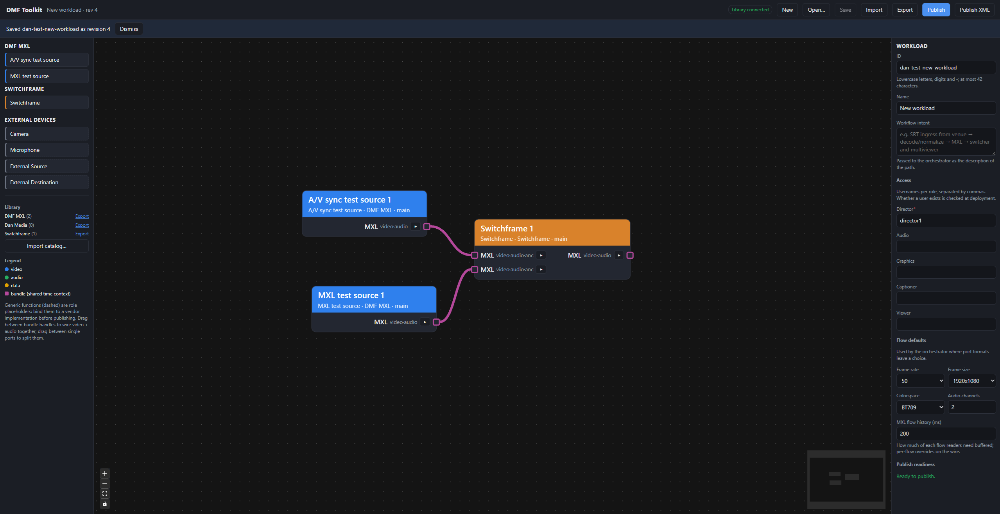
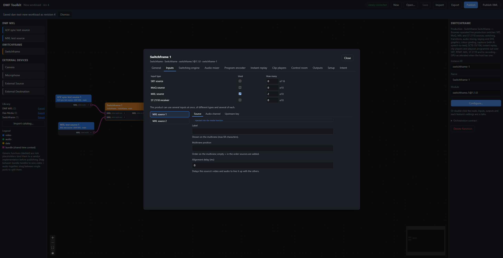
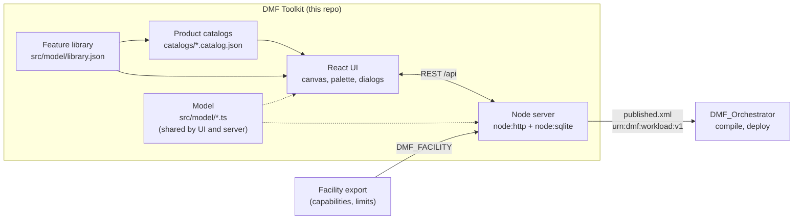

# DMF Toolkit

A web configurator for **Dynamic Media Facility** (DMF) workloads, as described in the EBU white
paper *The Dynamic Media Facility: Reference Architecture* (v2.0, April 2026).

In a DMF, a live production is built from software media functions (switchers, encoders, test
sources and so on) running as containers on shared IT infrastructure, and exchanging media over
[MXL](https://github.com/dmf-mxl/mxl) (the Media eXchange Layer). DMF Toolkit is where an operator
designs such a workload. They draw it on a canvas from models of real products, configure each
function, and publish the result as a **declarative desired state**. A separate orchestrator,
[DMF_Orchestrator](https://github.com/Kokovec/DMF_Orchestrator), compiles that state and deploys it.

> **The configurator is a high-level declarative language, and the orchestrator is its compiler.**
> The toolkit expresses intent, requirements and constraints. It never makes infrastructure
> decisions (hosts, replicas, addresses, buffer sizes) and never runs imperative steps.



## What it does

- **Design on a canvas.** Drag products from a palette (grouped by company) and External devices
  (cameras, remote sources, destinations) onto a node canvas, and wire them together. Inside the
  facility, media travels only as MXL flows between functions. External protocols such as SRT or
  RTMP appear only on edge ports facing External devices. Signals are IP only: there's no SDI.
- **Configure each function.** Double-click a function to open its dialog. It has these tabs:
  - **General:** turn optional features on and off.
  - **Inputs and Outputs:** choose how many of each kind, and configure each copy.
  - **One tab per feature:** for example the engine, audio mixer, keyers, replay, SCTE-35 and
    recording.
  - **Setup:** vendor settings, control and health, dependencies and resource requirements.
  - **Intent:** resilience, scaling and placement constraints.

  Forms are generated from JSON Schemas. They only offer valid combinations (for example, a
  resolution and frame rate the product actually supports), and they hide settings that don't
  apply.

  
- **Stay within what can actually be deployed.** Before publishing, the toolkit checks the design
  against three things:
  - **The product's own limits.** For example, Switchframe can't send HEVC over RTMP, or run MXL
    at 720p.
  - **Every value the orchestrator's compiler would refuse.**
  - **What the target facility can run.** The orchestrator exports a list of the facility's
    capabilities and limits, and the UI only offers what's on it. Options the facility can't run
    are shown as unavailable, with the reason.

  Each problem names the function and the parameter path, so the canvas, the dialog and the
  publish API all report the same thing.
- **Publish a desired state.** Saved workloads are versioned. Publishing produces an immutable
  revision, as JSON or as XML. The XML is checked against an XSD that is shared byte-for-byte with
  the orchestrator, and its output is deterministic. The published state includes these parts:
  - each function's selection, parameters and settings;
  - the MXL flows between functions, with deterministic UUIDs, formats and readers;
  - the wiring;
  - resource requirements, placement constraints and discovery metadata;
  - the access roles.

## How it's put together



### The layers

1. **Feature library** (`src/model/library.json`). A versioned data file that holds the shared
   vocabulary of the whole tool:
   - transports, External device kinds, access roles and facility capabilities;
   - the **features** that products are built from. A feature is an input (such as an SRT or MXL
     source), an output, an engine, an audio mixer, a keyer and so on. Each one has parameters
     (JSON Schema with `x-*` extensions for conditions, grouping, flow formats and valid
     combinations), ports, and design rules such as `requires`, `conflictsWith` and `maxPerModule`.

   The server refuses to start if the file changes without a version bump.
2. **Product catalogs** (`catalogs/`). Each module models one real product as a *design*: a set of
   feature blocks, narrowed to what that product supports, with defaults for a new instance. The
   catalogs are generated from code by `scripts/product-catalogs.ts` and loaded at server start.
   Two companies are modelled today:
   - **Switchframe**, a software production switcher. Its settings are mapped to its real
     configuration in [`docs/products/switchframe.md`](docs/products/switchframe.md).
   - **DMF MXL**, with an MXL test source and an A/V sync test source.
3. **Model** (`src/model/`). Plain TypeScript with no framework, used by both the UI and the server:
   - `compose.ts`: from a design to a module's ports and schema, and from an instance's selection
     to what it actually runs.
   - `schema.ts`: the JSON Schema subset, with validation and defaults.
   - `workload.ts`: canvas ↔ workload, wiring rules, publish checks, MXL flows and the published
     state.
   - `facility.ts`, `limits.ts`: facility capabilities and product limits.
   - `xml.ts`: a hand-written, deterministic XML encoder and reader for the published state.
4. **Server** (`server/`). Node 24's built-in `node:http` and `node:sqlite`, with no other runtime
   dependencies. It provides a REST API for these:
   - the library and its versions;
   - modules and catalogs;
   - workloads, with revisions;
   - the facility (`GET /api/facility`);
   - the published state (`GET /api/workloads/:id/published` and `/published.xml`).

   The SQLite schema migrates itself on start.
5. **UI** (`src/`). React 19 and [React Flow](https://reactflow.dev) for the canvas. The function
   dialog, inspector and forms are all driven by the schemas in the library.

### Contract with the orchestrator

The handover format is XML in namespace `urn:dmf:workload:v1`, defined by
[`schemas/dmf-workload-v1.xsd`](schemas/dmf-workload-v1.xsd). The orchestrator's copy is the
source of truth, and a test checks that this copy matches its hash. Two reference workloads in
`scripts/fixtures/` are round-trip fixtures that both repositories test:
- `studio-a`: two cameras and an A/V sync source into a Switchframe mixer over MXL;
- `every-value`: every value type and optional element.

[`docs/orchestrator-contract.md`](docs/orchestrator-contract.md) describes what the published
state contains.

## Setting up the environment

The toolkit runs on Linux, macOS, or Windows through WSL 2. It was developed on Ubuntu under WSL 2.
Apart from the Node.js packages, it has no database server or other services to install: the
server stores its data in a SQLite file, using Node's built-in `node:sqlite`.

### 1. Install the tools

| Tool | Needed for | Install |
| --- | --- | --- |
| **Git** | Cloning the repo | `sudo apt install git` (Ubuntu/WSL), `brew install git` (macOS) |
| **Node.js 24** and npm | Everything: the server needs Node 24 for `node:sqlite` | Through [nvm](https://github.com/nvm-sh/nvm), below |
| **xmllint** (optional) | XSD validation in the tests (otherwise skipped) | `sudo apt install libxml2-utils` (Ubuntu/WSL); included with macOS |
| **VS Code** (optional) | The workspace file `DMF Toolkit.code-workspace` | [code.visualstudio.com](https://code.visualstudio.com) |

To install Node.js 24 with nvm:

```sh
curl -o- https://raw.githubusercontent.com/nvm-sh/nvm/v0.40.3/install.sh | bash
# open a new terminal so nvm is on your PATH, then:
nvm install 24
nvm use 24
node --version   # v24.x
```

nvm adds itself to interactive shells only. If a script or editor task can't find `node`, put
Node 24 on its `PATH`. For example:
`export PATH="$HOME/.nvm/versions/node/<version>/bin:$PATH"`.

### 2. Clone and install

```sh
git clone https://github.com/Kokovec/DMF_Toolkit.git
cd DMF_Toolkit
npm install
```

`npm install` brings in React, React Flow, Vite, TypeScript, oxlint and tsx. The server itself
has no runtime dependencies beyond Node.

### 3. Check the setup

```sh
npm run build   # type-checks the UI and server
npm test        # the whole suite should pass
```

Some tests are skipped, rather than failing, when an optional piece is missing:
- XSD validation is skipped without `xmllint`.
- The checks against the orchestrator are skipped unless the tests can find a DMF_Orchestrator
  checkout. See step 5.

### 4. Configuration (optional)

The server reads these environment variables. None are needed for local development.

| Variable | Default | What it sets |
| --- | --- | --- |
| `PORT` | `3001` | The API port (the dev UI proxies `/api` to 3001) |
| `HOST` | `127.0.0.1` | The address the API listens on |
| `DMF_DB` | `data/dmf-toolkit.db` | The SQLite file (created on first start; `:memory:` for a throwaway database) |
| `DMF_CATALOGS` | `catalogs/` | Where the product catalogs are loaded from |
| `DMF_FACILITY` | unset | The orchestrator's facility export. Unset means everything is offered |

The tests also read `DMF_ORCHESTRATOR` and `DMF_FACILITY` (step 5).

The `data/` folder is git-ignored. Deleting it gives you an empty database on the next start.

### 5. The orchestrator (optional)

The toolkit designs and publishes on its own: you don't need the orchestrator to build or use it.
[DMF_Orchestrator](https://github.com/Kokovec/DMF_Orchestrator) is only needed to deploy what you
design, or to have the toolkit offer only what a real facility can run.

For the facility gating, you need the orchestrator's facility export. Producing it doesn't deploy
anything:

```sh
git clone https://github.com/Kokovec/DMF_Orchestrator.git
cd DMF_Orchestrator
make prereqs           # once: its tools and Python venv in ./.tools (no sudo)
make facility-export   # writes .state/facility-local.json
```

Then start the toolkit's server with `DMF_FACILITY` pointing at that file.

The two repositories share a contract, and a few tests check that this side still matches the
orchestrator's:
- the XSD copy in `schemas/` must be byte-identical to the orchestrator's;
- the facility capabilities the toolkit knows must be exactly the ones in the orchestrator's export.

To run those checks, tell the tests where your checkout is. The schema check needs only the clone.
The facility checks also need the export from the steps above.

```sh
DMF_ORCHESTRATOR=../DMF_Orchestrator npm test
```

`DMF_FACILITY` overrides the export's path, if you keep it elsewhere. Without a checkout, these
tests are skipped and the rest of the suite still passes. You only need them when you change the
schema, the capability list, or the orchestrator itself. The skip message says what's missing.

## Running and testing

```sh
npm run server   # API + SQLite on http://localhost:3001 (data in data/, git-ignored)
npm run dev      # UI on http://localhost:5173, proxies /api to the server
```

| Command | What it does |
| --- | --- |
| `npm run build` | Type-checks the UI and server, and builds the UI to `dist/` |
| `npm run lint` | Lints with oxlint |
| `npm test` | Runs the test suite (`node:test` via tsx): XML encoding and XSD validation, the API routes, publish checks, facility gating, product limits and compiler refusals |
| `npx tsx scripts/product-catalogs.ts` | Rebuilds the product catalogs (needed after a library change) |
| `npx tsx scripts/fixtures/write-xml.ts` | Regenerates the shared fixtures |

To limit the design to what a particular facility can run, point `DMF_FACILITY` at the
orchestrator's facility export (written by `make facility-export` in DMF_Orchestrator) before
starting the server:

```sh
DMF_FACILITY=../DMF_Orchestrator/.state/facility-local.json npm run server
```

Without it, everything is offered.

## Repository layout

| Path | Contents |
| --- | --- |
| `src/model/` | The model: types, feature library, composition, schemas, workload checks, facility, XML |
| `src/components/` | Canvas nodes, palette, inspector, function dialog, schema forms, setup |
| `server/` | REST API (`app.ts`), SQLite store and migrations (`db.ts`), start-up (`main.ts`) |
| `catalogs/` | Product catalogs, one per company (generated) |
| `schemas/` | The XSD shared with the orchestrator |
| `scripts/` | Catalog builder and the reference fixtures |
| `tests/` | The test suite |
| `docs/` | Design rules, the orchestrator contract, product mappings |

## Documentation

- [`docs/design-rules.md`](docs/design-rules.md) is the single source for design decisions. It
  lists the current rules by topic (each naming the code that enforces it), a dated decision log,
  and open questions.
- [`docs/orchestrator-contract.md`](docs/orchestrator-contract.md) describes the published desired
  state.
- [`docs/products/switchframe.md`](docs/products/switchframe.md) shows how the Switchframe module's
  settings map to the product's real configuration.
- `docs/primitives/`, `docs/media-primitive.md` and `docs/orchestration-model.md` are earlier
  design notes, kept for reference (see their banners).

## Status

This is a working prototype. Its limits today:
- Only the SRT input is fully parameterised. Parameters for the other inputs and outputs, more
  codecs and synchronizers are still to come.
- Switchframe is the only production product modelled in depth.
- There's no authentication. Access roles are published for the orchestrator to enforce, but the
  toolkit itself doesn't sign anyone in.

## License

[MIT](LICENSE)
